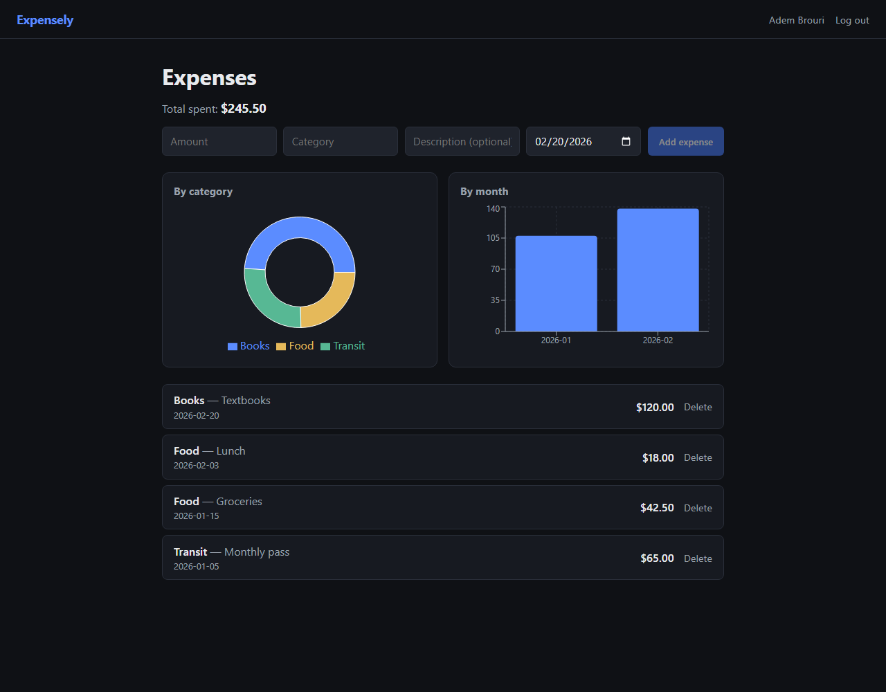

# Expensely

[](https://github.com/doudoumi14/expense-tracker/actions/workflows/ci.yml)

A full-stack expense tracker: log spending, categorize it, and see where your money goes via category and monthly breakdowns.



## Stack

- **Backend:** Python, FastAPI, SQLAlchemy + SQLite, PyJWT, bcrypt
- **Frontend:** React, TypeScript, Vite, Recharts
- **Tests:** pytest + FastAPI's TestClient

## Features

- Email/password signup and login (bcrypt-hashed passwords, JWT sessions)
- Add, edit, and delete expenses (amount, category, description, date)
- Spending broken down by category (pie chart) and by month (bar chart)
- All data scoped per-user

## Running locally

### Backend

```bash
cd backend
python -m venv venv
venv\Scripts\activate        # Windows; use `source venv/bin/activate` on macOS/Linux
pip install -r requirements.txt
cp .env.example .env
uvicorn app.main:app --reload --port 8000
```

The API listens on `http://localhost:8000`. Interactive docs are at `/docs`.

### Frontend

```bash
cd frontend
npm install
npm run dev
```

The app runs on `http://localhost:5173` and proxies `/api` requests to the backend.

### Tests

API tests (pytest, against a dedicated SQLite test database):

```bash
cd backend
venv\Scripts\activate
pytest
```

End-to-end browser tests (Playwright). Run from the repo root with the
virtualenv active — it boots the API and the frontend for you:

```bash
npm install
npx playwright install chromium
npm run test:e2e
```

## Project structure

```
expense-tracker/
  backend/        FastAPI app (models, routers, auth, tests)
  frontend/       React frontend (dashboard, charts, auth pages)
```
